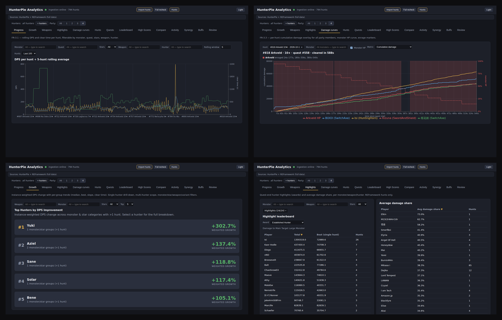
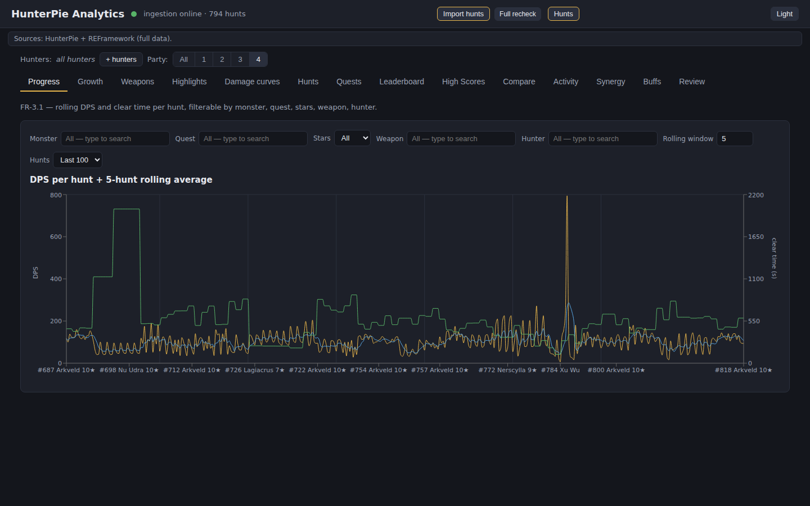
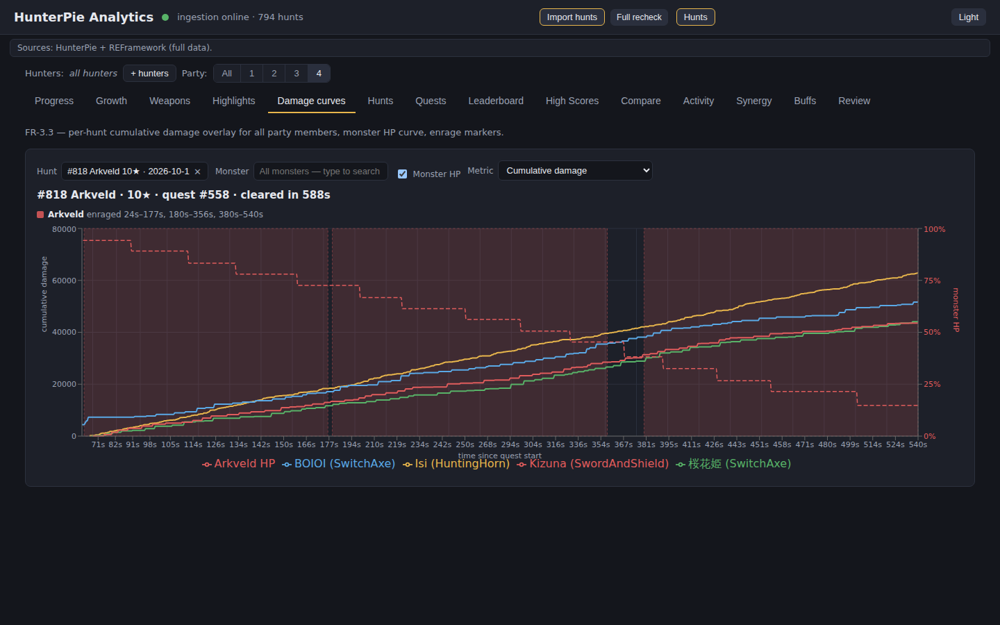
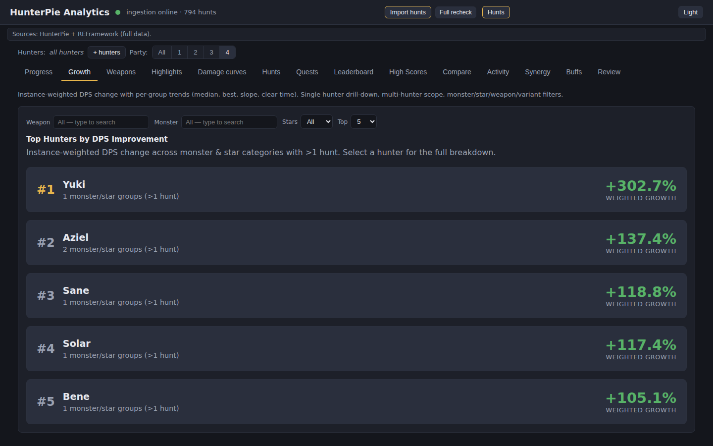
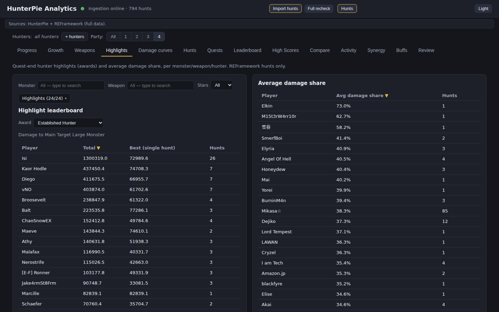
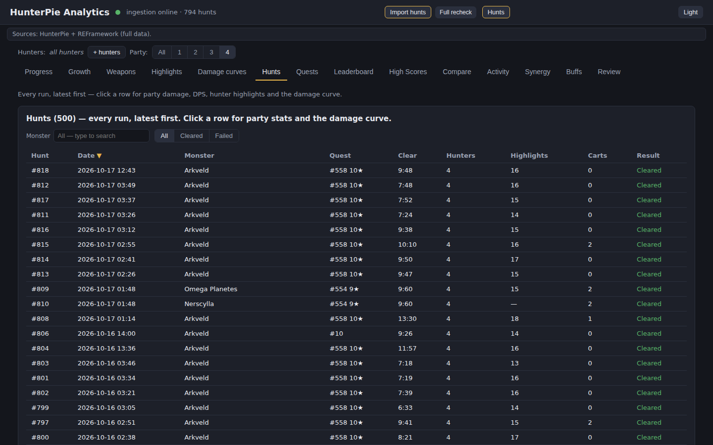
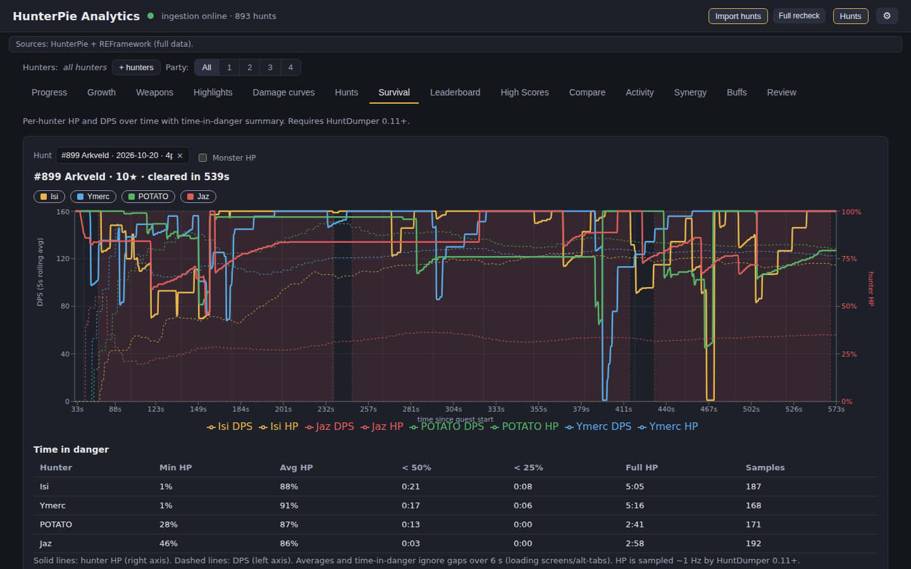
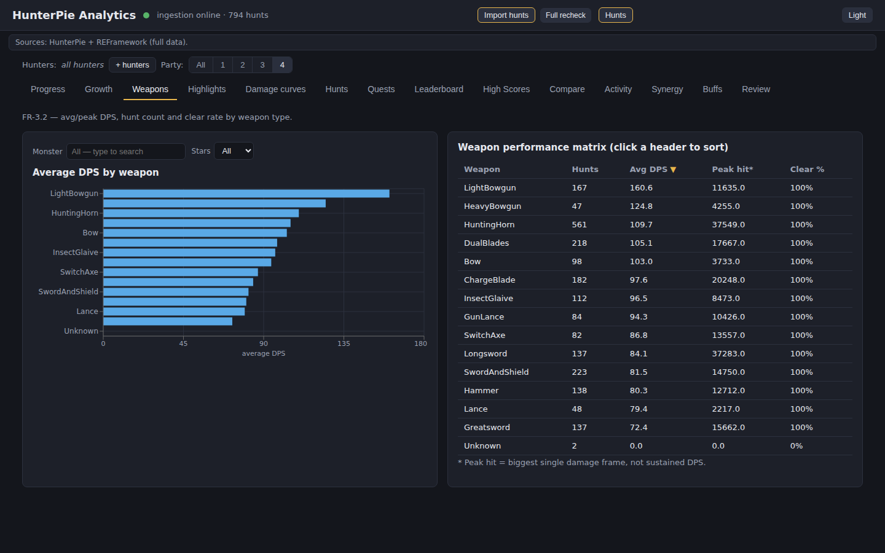
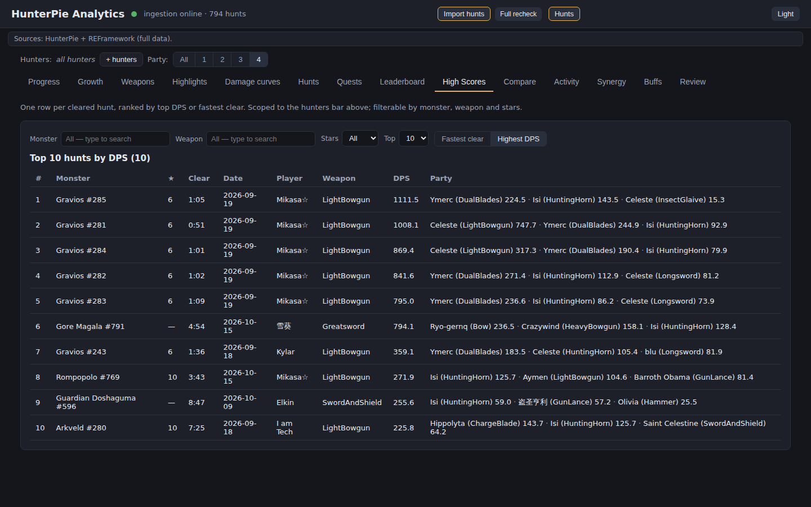

# HunterPie Analytics

**A post-hunt dashboard for Monster Hunter Wilds.** It graphs your hunts — DPS
and clear-time trends, per-party **damage curves** with the monster's HP,
weapon breakdowns, and the **30 quest-end awards** (hunter highlights). It runs
entirely on your own PC, offline.

[](LICENSE)
[](https://github.com/Diegoeyza/HunterPie_Analytics/releases)
[](#requirements)
[](#requirements)
[](https://github.com/Diegoeyza/HunterPie_Analytics/actions/workflows/ci.yml)



---

## Table of contents

- [What it is](#what-it-is)
- [Features](#features)
- [Screenshots](#screenshots)
- [Install (players)](#install-players)
- [Requirements](#requirements)
- [FAQ & troubleshooting](#faq--troubleshooting)
- [Privacy](#privacy)
- [Credits](#credits)
- [For developers](#for-developers)

---

## What it is

HunterPie Analytics reads **quest-end JSON dumps** written by capture tools and
turns them into an interactive dashboard: one row per hunt, per-player damage,
damage-over-time curves, clear-time trends, weapon stats, and the game's own
hunter-highlight awards. Everything is stored in a local SQLite database and
viewed in its own desktop window — no browser, no terminal, no account.

### Two capture sources — use either, or both

The dashboard works with whatever you have. Each source contributes different
data, and they merge per hunt (never double-counted):

| You have | You get |
|----------|---------|
| **REFramework + HuntDumper mod** (included) | Quest awards (hunter highlights), monster HP curve, damage totals, your weapon name, CPU-supporter flags |
| **HunterPie Analytics companion** (included) | Damage, weapon classes, DPS curves, buff/abnormality uptime |
| **Both** | Everything above, merged per hunt |

> **Already using HunterPie?** The standard HunterPie does **not** save hunt
> data, so this dashboard can't read it. Use the bundled **HunterPie Analytics
> companion** instead — it's the same HunterPie with local hunt export added,
> and it reuses your existing HunterPie settings. See the
> [FAQ](#faq--troubleshooting).

## Features

- **Damage curves** — cumulative damage or DPS (5-second rolling average) for
  every party member on one grid, with the monster's HP overlay and enrage
  markers. DPS runs from each hunter's own first hit to the party's last hit
  (the same window as the in-game meter); Settings can switch it to
  first-hit→last-hit.
- **Progress** — pick the measure: raw DPS, DPS vs your usual on that monster
  (100% = your median there), damage share of the party, or clear time — each
  with its own rolling average. The relative measures stop a harder fight or a
  stronger party from reading as a slump.
- **Growth** — instance-weighted DPS improvement per monster & quest-rank group,
  measured three ways: first → last hunt, first-3 vs last-3 medians (ignores a
  fluke at either end), or a trend fit through every hunt. A minimum hunt count
  keeps 2-hunt groups from dominating.
- **Highlights** — the 30 quest-end awards (hunter highlights) and average
  damage share, per monster / weapon / hunter.
- **Leaderboards & records** — best players by DPS, one row per cleared hunt
  ranked by DPS or clear time.
- **Weapons, Survival, Compare, Synergy, Activity, Buffs, Review** — weapon
  breakdowns, per-hunter HP and time-in-danger, you-vs-party comparisons,
  teammate pairings, daily activity, buff uptime, and hunter-name cleanup.

Every tab shares a **filter bar** (monster, quest, stars, weapon, hunter) and a
**hunter scope bar** — star yourself or teammates to focus the whole dashboard.
Scope, party size and the active tab sync to the URL, so views are shareable
and back-button safe.

**Settings (gear icon)** — switch light/dark theme, choose whether **failed
(carted-out) quests count in the stats**, and toggle **Check for updates**. By
default only cleared hunts feed DPS and rankings; clear-rate columns always
count failures. The setting is remembered and synced to the URL (`?failed=1`).
The update check is opt-out: turn it off for zero network access.

### The tabs

| Tab | What it shows |
|-----|---------------|
| **Progress** | DPS, DPS vs your usual, damage share or clear time per hunt — switchable — with a rolling average. |
| **Growth** | Instance-weighted DPS improvement per monster/star group, with first→last, edge-median and trend-fit modes. |
| **Weapons** | Average/peak DPS, hunt count and clear rate per weapon type. |
| **Highlights** | Quest-end awards (hunter highlights) + average damage share. REFramework hunts. |
| **Damage curves** | Per-hunt cumulative damage / DPS for all party members, monster HP overlay, enrage markers. |
| **Hunts** | Every run, latest first — click a row for party damage, DPS and the damage curve. |
| **Survival** | Per-hunter HP and DPS over time with time-in-danger summary. Requires HuntDumper 0.11+. |
| **Leaderboard** | Best players by DPS over cleared hunts. |
| **High Scores** | One row per cleared hunt, ranked by DPS or clear time. |
| **Compare** | Scoped hunters vs the whole party, hunt by hunt. |
| **Activity** | Hunts per day, clear rate, total damage. |
| **Synergy** | Clear time and damage share by teammate pairing. |
| **Buffs** | Abnormality/buff uptime per player per hunt, measured from hunt start or first hit. HunterPie data. |
| **Review** | Merge case-variant hunter names or keep them separate. |

## Screenshots

All screenshots are captured from the current build; the full set lives in
[`docs/images/`](docs/images).

| Progress | Damage curves |
|:---:|:---:|
|  |  |
| Rolling DPS and clear-time trend per hunt. | Per-party damage curves with the monster HP curve and enrage markers. |

| Growth | Highlights |
|:---:|:---:|
|  |  |
| DPS improvement over time. | The 30 quest-end awards and damage share. |

| Hunts | Survival |
|:---:|:---:|
|  |  |
| Every run, expandable to the full curve. | Per-hunter HP and DPS with the time-in-danger summary. |

| Weapons | High Scores |
|:---:|:---:|
|  |  |
| Average and peak DPS by weapon. | Best hunts by DPS or clear time. |

More: [`leaderboard.png`](docs/images/leaderboard.png),
[`compare.png`](docs/images/compare.png), [`synergy.png`](docs/images/synergy.png),
[`activity.png`](docs/images/activity.png), [`buffs.png`](docs/images/buffs.png),
[`review.png`](docs/images/review.png).

## Install (players)

You install **two things**: an in-game capture (a mod) and the dashboard. The
capture tool is what actually records your hunts; the dashboard reads it.

### 0. Download

Grab the latest release from **[GitHub Releases](https://github.com/Diegoeyza/HunterPie_Analytics/releases)**
(or the [Nexus Mods page](https://www.nexusmods.com/monsterhunterwilds/mods/5158)). Verify downloads with `SHA256SUMS.txt`.

| File | What it's for |
|------|---------------|
| `HunterPieAnalytics-Setup-<ver>.exe` | **Recommended.** One-click install (per-user, no admin): dashboard + companion + bundled mod. |
| `HuntDumper-<ver>.zip` | The REFramework mod only (game-folder layout, Vortex-ready). |
| `SHA256SUMS.txt` | Checksums for the two files above. |

### 1. The in-game capture (REFramework mod)

1. Install [REFramework](https://github.com/praydog/REFramework) for MH Wilds
   (`dinput8.dll` in the game folder).
2. Copy `hunt_dumper.lua` into `<game>\reframework\autorun\`
   (or install `HuntDumper-<ver>.zip` with Vortex).
3. Done — each quest writes a JSON dump to
   `<game>\reframework\data\HuntExports\`.

> Load the script **before** you start a quest. Reloading scripts mid-hunt
> resets its state and skips that hunt (the next one is fine).

### 2. The dashboard

1. Run `HunterPieAnalytics-Setup-<ver>.exe` — a per-user install, **no admin
   prompt**. (Or install the Store build.)
2. Launch **HunterPie Analytics** from the Start Menu / desktop. The dashboard
   opens in its own window.
3. Click **Import**. Your hunts appear. Click **Import** again after each
   session. A plain-language `GETTING_STARTED.txt` is installed alongside the app.

The app auto-detects the export folders and shows what it found at the top of
the window. To also record **DPS curves and weapon classes**, install
**HunterPie** with the [analytics-export fork](https://github.com/Diegoeyza/HunterPie)
or launch the bundled **HunterPie Analytics companion** (its own shortcut).

If setup finds an existing HunterPie, it automatically copies your settings
(`config.json`, overlays, theme and `Modules`) into the companion, so it starts
just like your current HunterPie. Your existing installation is left untouched.

The companion keeps up with **game patches on its own**: after a game update it
downloads just the new memory-offset maps (and localization) it needs, but never
replaces its own code.

The **dashboard updates itself in place**. When a newer release exists, an
**↑ vX.Y.Z available** pill appears in the header — click it and the app
downloads the verified installer, applies it, and reopens. Your settings and
hunt history are kept (they live outside the install folder). Prefer it manual?
Turn the check off in **Settings** and grab the installer from
[Releases](https://github.com/Diegoeyza/HunterPie_Analytics/releases).

### Uninstall

Windows **Settings → Apps → HunterPie Analytics**, or run `unins000.exe` in the
install folder. Your hunt history stays in `%LOCALAPPDATA%\HunterPieAnalytics`,
so reinstalling later keeps your data. Uninstalling never deletes exported
hunts.

## Requirements

| | |
|---|---|
| **OS** | Windows 10 / 11 (64-bit) for the capture tools and the desktop app. |
| **Game** | Monster Hunter Wilds (PC). |
| **Capture** | [REFramework](https://github.com/praydog/REFramework) for the bundled mod, and/or [HunterPie](https://github.com/HunterPie/HunterPie) with the [analytics-export fork](https://github.com/Diegoeyza/HunterPie). |
| **Runtime** | WebView2 (ships with Windows 11 / most Windows 10; the installer sets it up if missing). |
| **Privileges** | None — per-user install, no admin, no UAC. |

The dashboard/API also run on macOS/Linux for development (see
[For developers](#for-developers)); the game and capture tools are Windows-only.

## FAQ & troubleshooting

**Windows shows "Windows protected your PC" (SmartScreen).**
The direct-download installer and `.exe` are **not code signed yet**, and some
antivirus tools flag the PyInstaller bundle. Choose **More info → Run anyway**.
The Microsoft Store build is re-signed by Microsoft and shows no warning. See
[docs/CODE_SIGNING.md](docs/CODE_SIGNING.md).

**I already have HunterPie but the dashboard shows no data.**
Stock HunterPie does not export hunt data. Launch the bundled **HunterPie
Analytics companion** (Start Menu / desktop shortcut) instead — it's the same
HunterPie plus a local export file. Setup copies your existing HunterPie
settings into it, so it starts with your overlays and theme.

**My companion keeps my old settings / I want to start fresh.**
Setup copied your existing HunterPie `config.json` the first time. Edit the
settings inside the companion normally, or delete
`...\HunterPie-Fork\config.json` (and `internal\`) and relaunch it to
regenerate defaults.

**The dashboard opens but lists no hunts.**
Finish a quest first — the tools only write a file when a quest ends. Relaunch
the game after installing the mod, then click **Import**. Check the source
banner at the top: it names each export folder it detected.

**Where is my data?**
Exported hunts are JSON files in
`<game>\reframework\data\HuntExports\` (mod) and
`...\HunterPie-Fork\HuntExports\` (companion). The dashboard's own database is
in `%LOCALAPPDATA%\HunterPieAnalytics`. Nothing is uploaded anywhere.

**I use Mod Organizer 2 and the dashboard can't find my hunts.**
MO2 redirects writes made inside the game folder into its instance's
`overwrite\` folder, so the mod's dumps land in
`<MO2 instance>\overwrite\reframework\data\HuntExports\`. Standard MO2 instances
are detected automatically; for a portable instance, open **Settings (gear) →
Hunt exports folders**, add that path, then click **Import**.

**Does it work in multiplayer?**
Yes. Dumps include every party member, so curves, leaderboards and synergy work
for the whole party. CPU-supporters are flagged.

**Does it modify the game or talk to the network?**
No. The mod only *reads* game state and writes JSON; the dashboard only reads
those JSON files. Both are offline and open source (Apache-2.0).

**Failed hunts don't show up in the stats.**
That's the default: only cleared hunts feed DPS and rankings. Open **Settings
(gear) → Include failed hunts** to count carted-out quests too. Clear rates
always count failures either way.

**A quest is missing entirely.**
Hunts where no monster ever dropped below **40% HP** are treated as
"not engaged" and skipped at import (environment damage from a turf war isn't a
quest target). Failed quests bypass this and are stored. This is an import-time
filter, so those hunts can't be recovered later without re-importing.

**Multi-monster quests look split.**
One hunt row is created per monster, each carrying the full quest damage
(flagged as a split quest) — per-hit attribution isn't possible from the dump.

**Does it work with Vortex?**
Yes — install `HuntDumper-<ver>.zip`; it's laid out for the game folder and maps
into `reframework`.

**Do I need both tools?**
No. The mod alone gives awards, HP curves and damage; the companion adds DPS
curves and weapon classes. Use whichever, or both.

## Privacy

Everything runs locally and offline. The app sends no data anywhere and reads
only the JSON files your capture tools write. See [PRIVACY.md](PRIVACY.md).

## Credits

- [REFramework](https://github.com/praydog/REFramework) by **praydog** — the
  scripting framework the mod runs on.
- [HunterPie](https://github.com/HunterPie/HunterPie) by the **HunterPie team**
  (Apache-2.0) — the companion is built from a fork with local hunt export.
- This project is **Apache-2.0** — see [LICENSE](LICENSE).

---

# For developers

Post-hunt dashboard for **Monster Hunter Wilds**. Imports per-hunt JSON dumps
(quest-end snapshots) into SQLite and visualises them with Next.js + Recharts.

Two sources feed it, and they complement each other:

- **HunterPie** ([analytics-export fork](https://github.com/Diegoeyza/HunterPie)) — damage, weapon classes, DPS curves.
- **HuntDumper** (`reframework/hunt_dumper.lua`, a [REFramework](https://github.com/praydog/REFramework) mod) — quest awards (hunter highlights), the local player's weapon name, CPU-supporter flags, HP curve.

## How it works

```
HunterPie fork ──┐
                 ├─→ quest-end JSON in HuntExports/
HuntDumper mod ──┘     → import_hunt.py parses + upserts into SQLite
                          → FastAPI serves /api/* endpoints
                            → Next.js dashboard fetches and renders
```

## Prerequisites (dev)

- Python 3.10+
- Node.js 18+
- For real data: [HunterPie](https://github.com/HunterPie/HunterPie) with the [analytics-export fork](https://github.com/Diegoeyza/HunterPie) and/or the [REFramework](https://github.com/praydog/REFramework) mod (`reframework/hunt_dumper.lua`).

## Quick start

```sh
# 1. Set up
python3 -m venv .venv
.venv/bin/pip install -r backend/requirements.txt
npm install --prefix dashboard

# 2. Seed demo data (31 synthetic hunts)
cd backend && ../.venv/bin/python -m app.seed --db hunts.db --hunts 31 && cd ..

# 3. Run
./start.sh   # API → :8000, Dashboard → :3000
```

Open **http://localhost:3000**.

## Importing real hunts

With the [analytics-export fork](https://github.com/Diegoeyza/HunterPie) installed,
every quest completion dumps a JSON to `C:\Program Files\HunterPie\HuntExports\`.

```sh
# Import all hunts from HuntExports
./import.sh

# Single file
./import.sh --file "/mnt/c/src/hunt-sample.json"

# Custom folder
./import.sh --dir "/path/to/HuntExports"
```

Re-imports are idempotent — existing hunts are skipped, new ones are added.
Run `./import.sh` after each hunting session to pull in new data.

In the desktop app, **Settings (gear) → Hunt exports folders** adds extra
folders to scan (for example a portable Mod Organizer 2 instance's
`overwrite\reframework\data\HuntExports`). `HUNT_EXPORTS` still overrides the
configured list for Docker/source runs.

## Scripts

| Script | What it does |
|--------|-------------|
| `./start.sh` | Starts API (`:8000`) + dashboard (`:3000`). Ctrl+C kills both. |
| `./import.sh` | Imports hunt JSONs from `C:\Program Files\HunterPie\HuntExports\`. |
| `./import.sh --file path.json` | Imports a single hunt file. |
| `./import.sh --dir /path` | Imports from a custom directory. |

## Dashboard internals

### Scope bar

Star hunters in the top bar to focus views on specific players.
Scope applies to Progress, Growth, Weapons, Damage curves, Hunts, Leaderboard,
High Scores, Compare, Synergy, Survival, and Buffs (Activity stays global).
Scope, party size, and the active tab sync to the URL (`?tab=&scope=&party=`) —
shareable links, back-button safe. Stored in `localStorage` too — survives refreshes.

### Damage curves features

- **Metric toggle**: Cumulative damage or DPS (5s rolling average)
- **Monster HP overlay**: Dashed red line, right Y-axis (0–100%)
- **Enrage markers**: Light red shaded regions on the chart
- **DPS from first hit**: own first hit to the party's last hit (switchable to first→last hit in Settings)
- **Multi-party**: All party members plotted on the same grid

## Architecture

### Backend (`backend/`)

- **Framework**: FastAPI + SQLAlchemy + SQLite
- **Tables**: `players`, `player_aliases`, `weapons`, `monsters`, `hunts`, `hunt_players`, `dps_snapshots`, `monster_events`, `monster_health_steps`, `player_abnormalities`, `weapon_identities`, `player_pins`, `imported_files`, `awards`, `hunt_player_awards`
- **Query layer**: `queries.py` (metrics) + `filters.py` (shared scope/party/visibility + strict parsing) + `engagement.py` (DPS windows) + `variants.py` (gear fingerprints)
- **API port**: `:8000` (or `$PORT`)
- **DB path**: `backend/hunts.db` (or `$HUNTS_DB`)
- **Schema**: `db/schema.sql` (+ `test_schema_drift` fails on models/schema drift)
- **Migrations**: versioned, `PRAGMA user_version` in `app/db.py:MIGRATIONS` — `init_db()` upgrades any old DB in place

### Dashboard (`dashboard/`)

- **Framework**: Next.js 15 + Recharts 3 + TypeScript
- **Port**: `:3000`
- **API URL**: `http://localhost:8000` (or `$NEXT_PUBLIC_API_URL`)
- **Pattern**: Tab registry — add a view by creating a file in `components/views/` and adding an entry to `lib/registry.tsx`. Data via `useApi()` (`lib/useApi.tsx`), filters via `components/FilterBar.tsx`, charts via `components/ChartKit.tsx`.

### Key files

```
backend/
  app/api.py            FastAPI routes + validation (422/409) + CORS
  app/queries.py        All metric queries (one function per tab)
  app/filters.py        Shared scope/party/visibility + strict param parsing
  app/engagement.py     DPS engagement windows (batched)
  app/variants.py       Weapon-variant clustering + filter resolution
  app/ingest.py         upsert_hunt() — validated, atomic, idempotent, n-player
  app/import_hunt.py    Poogie JSON parser + CLI (logging, split-quest flags)
  app/import_job.py     Background imports: single-flight, cancel, manifest
  app/seed.py           Deterministic demo data generator (importer-identical)
  app/db.py             Shared engine + per-connection pragmas + migrations
  app/models.py         SQLAlchemy models (15 tables)
  bench.py              1000-hunt endpoint latency bench
  tests/                Backend tests (import + API + ingest + jobs + drift + highlights)

dashboard/
  app/page.tsx          Root page: URL-synced tab/scope/party, health, toasts
  lib/registry.tsx      Tab registry (14 TABS)
  lib/api.ts            Typed fetch helpers + cache
  lib/useApi.tsx        SWR-lite data hook + ApiState
  lib/url.ts            Query-param state helpers
  lib/format.ts         fmtTime/fmtDps/fmtPct/fmtInt/fmtDate/roundDps
  components/views/     One file per tab
  components/ScopeBar.tsx   Hunter pin/scope/party UI
  components/FilterBar.tsx  Shared Monster/Stars/Weapon/Hunter selects
  components/ChartKit.tsx   Theme-aware chart constants
  components/Modal.tsx      Single modal system
  components/Toast.tsx      Toast notifications

Makefile              setup/seed/dev/test/lint/build/bench/import/package/clean
docker-compose.yml    API + dashboard containers (DB on ./data volume)
.github/workflows/ci.yml  pytest + tsc on push/PR
db/schema.sql           Source of truth for schema
docs/ADDING_A_VIEW.md   How to add new tabs/metrics
```

## Adding a new tab

1. Create `dashboard/components/views/MyView.tsx`
2. Add entry to `dashboard/lib/registry.tsx`:
   ```ts
   { id: "my-tab", title: "My Tab", blurb: "Description.", render: (ctx) => <MyView scope={ctx.scope} /> }
   ```
3. Add query to `backend/app/queries.py`
4. Add route to `backend/app/api.py`
5. Done — no other files change.

See [docs/ADDING_A_VIEW.md](docs/ADDING_A_VIEW.md) for details.

## Adding a new metric to an existing tab

1. Add query function in `backend/app/queries.py`
2. Add route in `backend/app/api.py`
3. Fetch it in the view component

## Tests

```sh
make test   # backend pytest + dashboard typecheck

# Backend — granular:
cd backend && ../.venv/bin/python -m pytest tests -q

# Dashboard (type check)
cd dashboard && npx tsc --noEmit

# Lint
.venv/bin/python -m ruff check backend/app backend/tests

# Perf bench (1000 hunts)
make bench
```

## Known limitations

- **Multi-monster quests**: one hunt row per monster, each carrying full quest damage (flagged `is_split_quest`; per-hit attribution impossible from the dump)
- **HunterPie/game versions**: Not in the JSON dump — defaults to `2.14.0.466-analytics` / `1.042.00.02`, override with `--hunterpie-version` / `--game-version`

## Sharing / packaging

See [docs/SHARING.md](docs/SHARING.md). The REFramework mod, the HunterPie fork,
and this app are independent pieces.

Every release on **GitHub Releases** carries these files (built by CI, see
`.github/workflows/release.yml`):

| Artifact | Where | Contents |
|----------|-------|----------|
| `HunterPieAnalytics-Setup-<ver>.exe` | GitHub Releases | One-click per-user installer (desktop app + bundled companion + Lua mod) |
| `HuntDumper-<ver>.zip` | GitHub Releases, Nexus | REFramework mod, game-folder layout (Vortex-ready) |
| `SHA256SUMS.txt` | GitHub Releases | Checksums for the two files above |
| `HunterPie-AnalyticsFork.zip` | CI artifact (`Build HunterPie fork`) | Prebuilt analytics-export companion, for HunterPie-only users |
| `HunterPieAnalytics-<ver>.msix` | Microsoft Store (built locally) | Store package, dashboard only |

Local, developer-oriented bundle (no Windows build tools needed):

```sh
make package   # dist/: REFramework mod zip + full app source zip
```

To build the desktop app locally on Windows:

```powershell
powershell -ExecutionPolicy Bypass -File packaging\build-windows.ps1
iscc installer\HunterPieAnalytics.iss
```

See [docs/RELEASING.md](docs/RELEASING.md) for signing/Store setup and how to
cut a release, and [docs/NEXUS.md](docs/NEXUS.md) for the Nexus Mods listing kit.

## License

Apache-2.0 — see [LICENSE](LICENSE).
